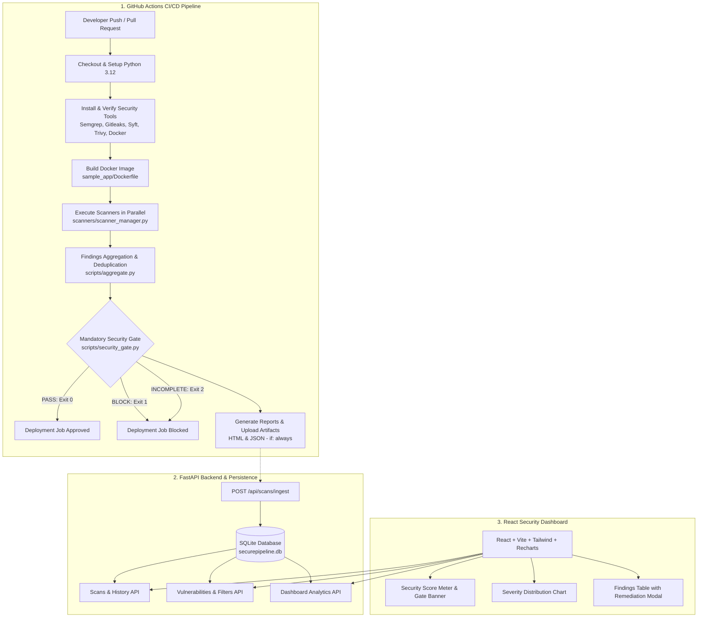

# SecurePipeline: Automated CI/CD Vulnerability Detection System

**SecurePipeline** is an enterprise-grade DevSecOps platform that injects automated security testing directly into Continuous Integration and Continuous Deployment (CI/CD) pipelines. It shifts security left by automatically scanning source code, hardcoded secrets, dependencies, and container images on every code commit, enforcing a fail-closed security gate that prevents vulnerable applications from reaching production.

---

## 🌟 Key Features

* **Static Application Security Testing (SAST):** Scans source code for command injection, insecure `eval`, and OWASP Top 10 flaws using **Semgrep**.
* **Hardcoded Secret Detection:** Detects exposed API keys, tokens, and credentials with automatic secret value redaction using **Gitleaks**.
* **Software Bill of Materials (SBOM):** Generates full component inventories using **Syft** without misclassifying inventory packages as vulnerabilities.
* **Dependency & Container Vulnerability Scanning:** Scans application dependencies and Docker container layers against CVE databases using **Trivy**.
* **Fail-Closed Security Gate:** Mandatory policy enforcement that blocks deployment on `CRITICAL` or `HIGH` vulnerabilities, allows `MEDIUM` and `LOW` with warnings, and fails closed (`INCOMPLETE`) if required scans are missing or fail.
* **Audit-Ready Reporting:** Produces both structured machine-readable `security_report.json` and visual `security_report.html` reports with dynamic status badges and transparent security score auditing.
* **FastAPI Backend + SQLite:** Relational storage for scan runs, vulnerabilities, and scanner health tracking with atomic database transactions.
* **Modern React Operations Dashboard:** Dark-navy enterprise UI displaying live security scores, severity breakdown charts, scanner execution matrices, and vulnerability remediation guidance.
* **Risk-Based Prioritization:** Every finding receives a contextual risk score (1–100) and a P0–P3 priority using severity, reachability, exploit impact, and whether a fix is already published.
* **Regression Tracking:** Scan history compares consecutive pipeline runs and marks the security score as improved, regressed, or unchanged.
* **Remediation Assistant:** Finding details and the Code Analyzer show why code is unsafe and a concrete replacement snippet.

---

## 📐 System Architecture



---

## 🔒 Security Gate Decision Matrix

| Gate Decision | Condition | Pipeline Action | Exit Code |
| :--- | :--- | :--- | :--- |
| **`PASS`** | All required scanners succeeded AND zero Critical/High vulnerabilities found. | **Deployment Approved** | `0` |
| **`BLOCK`** | All required scanners succeeded, but `CRITICAL` or `HIGH` findings were detected. | **Deployment Blocked** | `1` |
| **`INCOMPLETE`** | Any required scanner was missing, skipped, or failed execution. | **Deployment Blocked (Fail-Closed)** | `2` |

---

## 📁 Repository Layout

```text
securepipeline/
├── .github/
│   └── workflows/
│       └── security.yml           # Mandatory GitHub Actions CI/CD workflow
├── scanners/                      # Safe subprocess scanner wrappers
│   ├── __init__.py
│   ├── semgrep_scanner.py         # Semgrep SAST wrapper
│   ├── gitleaks_scanner.py        # Gitleaks secret scanner with redaction
│   ├── syft_scanner.py            # Syft SBOM generator wrapper
│   ├── trivy_scanner.py           # Trivy FS and Image scanner wrapper
│   └── scanner_manager.py         # Unified multi-scanner coordinator
├── scripts/                       # Gate policy, aggregation, and reporting
│   ├── __init__.py
│   ├── aggregate.py               # Findings deduplication & schema normalization
│   ├── security_gate.py           # Fail-closed gate decision engine
│   ├── report_generator.py        # JSON & HTML report builder
│   └── validate_workflow.py       # GitHub Actions YAML syntax validator
├── sample_app/                    # Test application with intentional vulnerabilities
│   ├── app.py                     # Demo Flask app (command injection & dummy key)
│   ├── requirements.txt           # Vulnerable pinned package versions for CVE testing
│   └── Dockerfile                 # Container image specification
├── dashboard/
│   ├── backend/                   # FastAPI backend service
│   │   ├── app/
│   │   │   ├── main.py            # FastAPI entrypoint & CORS
│   │   │   ├── models.py          # SQLAlchemy models (Scan, Finding, ScannerExecution)
│   │   │   ├── schemas.py         # Pydantic v2 schemas
│   │   │   ├── crud.py            # Database transactions & KPI aggregations
│   │   │   └── routers/           # Scans, Findings, Dashboard routers
│   │   └── tests/                 # Backend automated test suite
│   └── frontend/                  # React + Vite DevSecOps dashboard
│       ├── src/
│       │   ├── components/        # Header, ScoreCard, Charts, Tables, Modals
│       │   ├── api.js             # Axios client
│       │   └── App.jsx            # Main dashboard interface
│       ├── package.json
│       └── vite.config.js
├── tests/                         # Scanner & security gate unit tests
├── reports/                       # Generated scan artifacts (raw, JSON, HTML)
└── requirements.txt               # Root project dependencies
```

---

## ⚡ Quick Start: Running the Project Locally

### 1. Prerequisites
* **Python 3.11+**
* **Node.js v18+ & npm**
* **Git**

### 2. Backend Setup (Terminal 1)
```powershell
cd dashboard/backend

# Install dependencies
pip install -r requirements.txt

# Start FastAPI server
uvicorn app.main:app --host 127.0.0.1 --port 8000 --reload
```
* API Server: `http://127.0.0.1:8000`
* Interactive Swagger Docs: `http://127.0.0.1:8000/docs`

### 3. Frontend Setup (Terminal 2)
```powershell
cd dashboard/frontend

# Install dependencies
npm.cmd install

# Start Vite development server
npm.cmd run dev
```
* Dashboard URL: `http://localhost:5173`

---

## 🧪 Automated Testing

SecurePipeline features a comprehensive test suite covering execution contracts, schema normalization, gate logic, secret redaction, and API endpoints:

```powershell
# Run Scanner, Aggregator & Security Gate Tests (22 tests)
python -m unittest discover -s tests -v

# Run FastAPI Backend & SQLite Tests (40 tests)
cd dashboard/backend
python -m unittest discover -s tests -v
```
**Total: 62 Automated Tests — 100% Passing.**

---

## 🚀 Live CI/CD Demonstration Walkthrough (Viva / Presentation Script)

Follow this 10-step demonstration sequence to showcase the complete DevSecOps lifecycle:

1. **Open the Dashboard:** Open `http://localhost:5173` showing the dark-navy security dashboard.
2. **Show the Repository:** Display the Git structure, `.github/workflows/security.yml`, and `sample_app/`.
3. **Highlight Intentional Flaws:** Show `sample_app/app.py` containing insecure `subprocess` (shell=True), eval, and dummy API key, plus vulnerable dependencies in `requirements.txt`.
4. **Push Code to GitHub:** Execute `git push origin main`.
5. **Open GitHub Actions:** Show the `security-pipeline` job starting automatically on Ubuntu runner.
6. **Watch Tool Execution:** Show Semgrep, Gitleaks, Syft, and Trivy executing, followed by the Docker image build and scan.
7. **Observe Gate Policy Enforcement:** Show `scripts/security_gate.py` detecting High/Critical vulnerabilities and exiting with **Code 1 (BLOCK)**.
8. **Verify Deployment Blocked:** Point out that the `deploy` job was skipped/prevented because the security gate blocked the pipeline.
9. **Inspect Security Reports:** Download `securepipeline-security-reports` artifact and open `security_report.html` in browser.
10. **Ingest & View in Dashboard:** Show the newly ingested scan on the live dashboard, with Critical/High vulnerability cards, severity charts, and remediation recommendations.

---

## ⚖️ Limitations & Future Work

* **Local Scanners on Windows:** While the Python wrappers run cross-platform, local scanning on Windows requires pre-installing the CLI binaries (`semgrep`, `gitleaks`, `syft`, `trivy`) or executing via WSL/Docker. The CI/CD pipeline installs and runs them natively on Ubuntu.
* **Remediation text is rule-based:** Suggested fixes are generated from vulnerability type and scanner metadata. They do not call an external language-model API.
* **Enterprise Identity:** Future enhancements can integrate OAuth 2.0 / OIDC (GitHub/Okta) for role-based developer access control.
